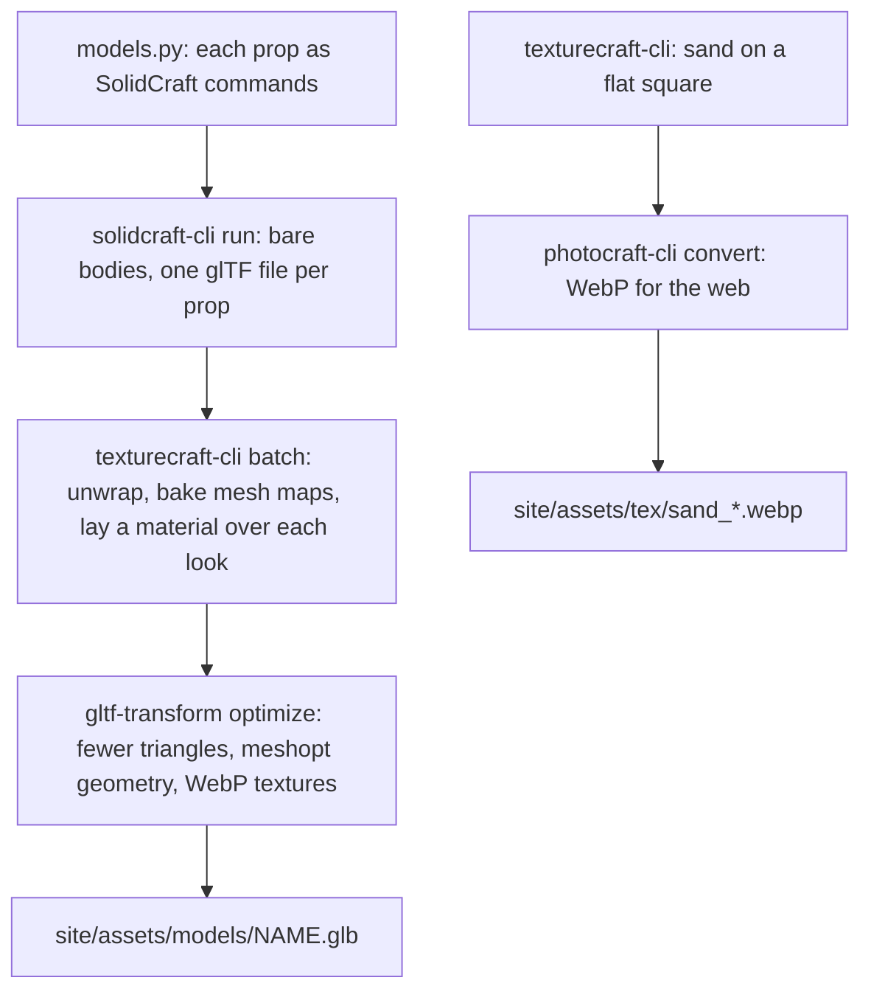

# How the scene is made

The website's first screen is a scene: a plain at dusk where each thing
standing on it is a piece of Nostr. Nothing in it was drawn by hand or
downloaded. Every prop is a script, and three programs turn the scripts
into the files a browser draws:



| File | What it holds |
|---|---|
| `models.py` | The props, in millimetres, and the looks they are made of |
| `craft.py` | `Design`, which collects SolidCraft commands, and the three steps |
| `build.py` | Runs the steps for the props named, or for all of them |
| `still.py` | Takes the picture shown where the scene itself is not drawn |

## Making the props again

The props are kept in the repository as files (`site/assets/models`,
`site/assets/tex`, `site/assets/still.jpg`), so assembling the site
(`just site`) needs none of this. To change one:

```sh
just site-props            # all of them: about a minute and a half
just site-props tower      # one
python3 site/craft/build.py --bare tower   # its shape only: a picture in target/site-craft/tower.png
just site-still            # the picture of the whole scene, once the props are right
```

That takes `solidcraft-cli` ([SolidCraft](https://solidcraft.io)),
`texturecraft-cli` and `photocraft-cli` (of the
[ArtCraft](https://getartcraft.com/apps) suite) on the `PATH`,
`npm` for glTF Transform, and, for the still, Playwright with Chromium.
What TextureCraft paints depends on its version and on the GPU it bakes
with, so files made again are not the same byte for byte.

## Adding a prop

1. Write a function in `models.py` that returns a `Design`, standing on
   Z = 0 about its own origin, and add it to `MODELS`. Give each body one of
   the `LOOKS`, or add a look: a colour and a TextureCraft material.
2. `python3 site/craft/build.py --bare NAME` and look at the picture.
3. `just site-props NAME`, then load and place it in `site/scene/world.js`
   (`PLACES`), and, if it is something to go up to, give it an entry in
   `SUBJECTS` and an `<article data-subject="…">` in `site/index.html`:
   the words shown beside a prop are the page's own.
